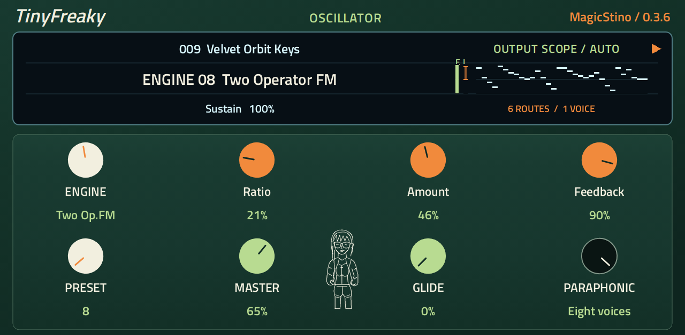
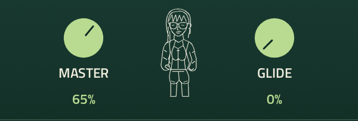

TinyFreaky
=========

An **8-voice synthesizer by MagicStino** for Akai Force, Windows, macOS and Linux.

Version 0.3.9 preserves externally played chords across host playback-position changes and corrects note stealing and overlapping note releases. It retains the fuller plucks and clearer noise playback introduced in 0.3.8.

Play with 16 engines, shape the sound with the 5 × 7 modulation matrix, and build patterns with the arpeggiator, swing and 64-step sequencer. The green, orange and white panel has large labels, a clear engine display and a live output scope.

The white line-art mascot follows pitch and note velocity: low notes bring hip sway, harder playing adds head movement, and occasional varied loops keep it lively. It settles after release.

Downloads
---------

Get the latest version from `Releases <https://github.com/MagicStino/TinyFreaky/releases/latest>`_.

* **Force:** ARMv7 package through the OpenPlugin catalog.
* **Windows:** 64-bit VST3.
* **macOS:** universal Intel/Apple Silicon VST3 and Audio Unit.
* **Linux:** 64-bit VST3.

The macOS builds are ad-hoc signed and are not Apple-notarized. The AU is checked with Apple's Audio Unit validator before publication.

Patches and projects
--------------------

456 TinyFreaky-named patch slots keep stable IDs and sound settings. 342 slots are playable; 114 require unavailable engines and are clearly marked. Six engine families and full sequence/sample payload support remain unfinished.

Save the instrument in your project to retain its settings. Install the entire desktop plug-in bundle and follow the instructions included with its download.

Source and license
------------------

Source and updates: https://github.com/MagicStino/TinyFreaky

Plugin code is MIT. Required licenses and copyright notices for reused code are included in THIRD_PARTY_NOTICES.md.
